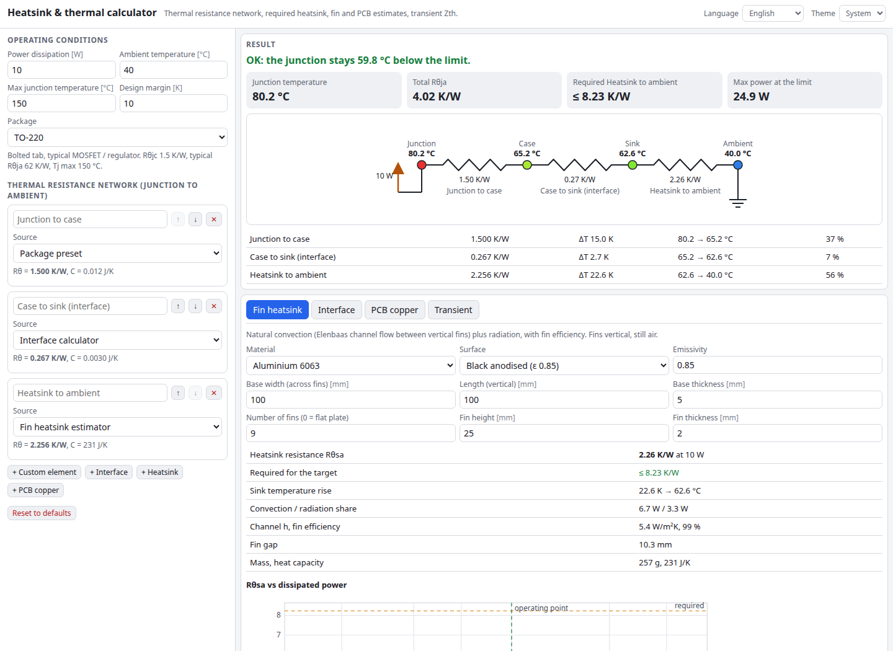

# Heatsink & Thermal Calculator

A free, fully client-side thermal design tool for electronics. Build a junction → case → interface → heatsink → ambient thermal resistance network, see every node temperature, get the heatsink Rθ you actually need, estimate natural-convection plate-fin heatsinks and PCB copper-pour cooling, and plot transient thermal impedance for pulsed loads. English and Ukrainian, light/dark theme, nothing leaves your browser.

**Try it:** https://hermes98761234.github.io/heatsink-thermal-calculator/

[](https://github.com/hermes98761234/heatsink-thermal-calculator/actions/workflows/deploy.yml)



## Features

- **Thermal network builder** with a live diagram: reorder, add and remove elements, each from a manual value, a package preset or one of the estimators. Node temperatures, ΔT per element and each element's share of the total.
- **Required heatsink Rθ**: `Rθsa ≤ (Tjmax − margin − Ta)/P − ΣR(other elements)`, plus the maximum power at the limit and a clear OK / marginal / too-hot verdict.
- **Package presets**: TO-220, TO-247, TO-3P, DPAK, D²PAK, SOT-223, PowerPAK SO-8 / LFPAK, QFN with thermal vias (Rθjc, tab area, Tj max, heat capacity).
- **Interface materials**: dry contact, grease, phase-change, gap pads, mica; `R = (t/k + R_contact)/A` from the tab area.
- **Natural-convection plate-fin heatsink**: Elenbaas channel flow between vertical fins, Churchill–Chu flat plate, radiation, fin efficiency, mass and heat capacity, Rθsa vs power chart, solved against your power.
- **PCB copper heatsinking**: radial fin model of a copper pour (area, oz, one or both sides, orientation), thermal via arrays, Rθ vs copper area chart.
- **Transient**: every element becomes a Foster stage (R, τ = R·C); Zth(t) plot, junction temperature under a pulse train, single-pulse and steady periodic peak.
- Settings and inputs persist in localStorage. Installable as a PWA-style web app (manifest), no backend, no tracking.

## How it works

All maths lives in `src/lib/thermal.ts` as pure, unit-tested functions:

- Series network: `Tj = Ta + P·ΣRθ`, node temperatures by stepping down from the junction.
- Air properties from power-law fits (ν, k, Pr = 0.707), Rayleigh number at the film temperature, Churchill–Chu vertical plate, McAdams horizontal plate, Elenbaas isothermal channel, linearised radiation `ε·σ·(Ts²+Ta²)(Ts+Ta)`.
- Fin efficiency `tanh(mL)/(mL)` with `m = √(2h/(k·t))`; the surface temperature rise is found by bisection so that convection plus radiation equals the dissipated power.
- Via barrel resistance `L/(k·π·t_p·(d − t_p))`.
- Foster model `Zth(t) = Σ Rᵢ(1 − e^(−t/τᵢ))`, pulse trains by superposition, exact steady periodic peak `Σ Rᵢ(1 − e^(−tp/τᵢ))/(1 − e^(−T/τᵢ))`.

Limitations: these are engineering estimates for design guidance, not CFD. Natural convection depends on enclosure, orientation and altitude; the PCB model ignores internal planes and neighbouring heat sources; package Rθjc values are typical datasheet numbers, so use your part's datasheet for final designs.

## Quick start

```sh
npm install
npm run dev        # development server
npm run lint && npm test && npm run build
```

Pushes to `main` deploy `dist` to GitHub Pages via `.github/workflows/deploy.yml`.

## License

MIT, see [LICENSE](LICENSE).
